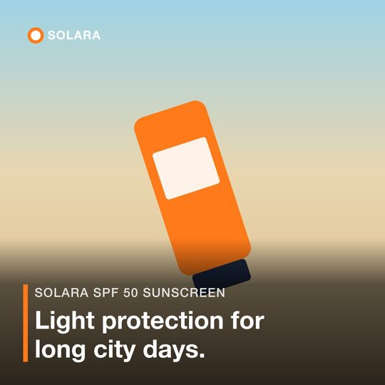
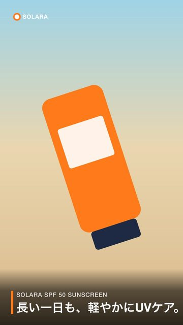
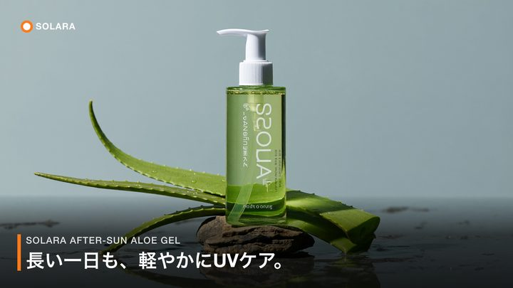
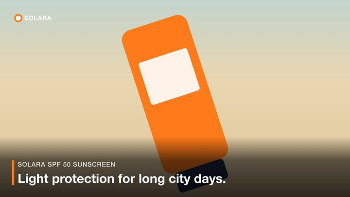

# Creative Automation Pipeline

One campaign brief in, a folder of social ads out: every product, every market language, three aspect ratios. Each ad is checked for brand, legal and visual problems before a person sees it.

```
npm install
npm start
```

That runs the example brief with a built-in mock image model. It needs no keys and costs nothing. It makes 12 ads plus a report in about a second.

## What it does

```
brief.yaml ──► validate ──► hero image per product ──► per locale: legal check ──► per ratio: crop, text, logo ──► checks ──► out/
                             reuse examples/assets/<id>/      (fail closed)                                  contrast, logo,
                             or generate (Higgsfield)                                                       palette, visual QA
```

For each product:

1. **Hero image.** If `assets/<product-id>/` next to the brief holds an image, it is reused. If not, one is generated in each ratio.
2. **Legal check.** The product name and message are checked against the brand's prohibited words. A hit blocks that locale. No ad is made from blocked copy.
3. **Render.** The hero is cropped to 1:1, 9:16 and 16:9. A dark gradient, the message, the product name and the logo go on top.
4. **Checks.** Each finished ad is measured and judged (see below). The results go to `report.json`.

Output:

```
out/summer-sun-mx/
  report.json
  solara-spf50/1x1/en-US.png   1x1/es-MX.png   9x16/...   16x9/...
  solara-aloe-gel/hero-1x1.png  hero-9x16.png  hero-16x9.png   (what the model returned, before edits)
                  1x1/en-US.png ...
```

The exit code is `0` when everything ran, `2` when copy was blocked or a product failed, and `1` on a bad brief or crash. A scheduler or CI job can act on it.

## Run it

Requires Node 20.6 or later.

| Command | What it does | Keys | Cost |
|---|---|---|---|
| `npm start` | Example brief, mock images | none | free |
| `npm run start:live` | Example brief, real AI images from Higgsfield | `HF_CREDENTIALS` | under 2 cents |
| `npm run start:live -- --brief examples/brief-jp.yaml` | Japan brief: English and Japanese copy | `HF_CREDENTIALS` | under 2 cents |
| `npm test` | 10 tests, no network | none | free |
| `node --env-file=.env.local scripts/probe-visual.js out/summer-sun-jp` | Runs 7 known cases through visual QA (needs a live run first) | `TYPESAFE_API_KEY` | a fraction of a cent |

CLI options:

```
node src/cli.js --brief <file.yaml|json> [--out ./out] [--provider mock|higgsfield]
```

### Keys

Copy `.env.example` to `.env.local` and fill it in. `.env.local` is git-ignored. Keys are read at runtime and never logged.

| Variable | Used for | If missing |
|---|---|---|
| `HF_CREDENTIALS` | Generating hero images (`key-id:key-secret` from console.higgsfield.ai) | `--provider higgsfield` stops with a clear error. Mock still works. |
| `TYPESAFE_API_KEY` | Visual QA of hero images | Visual check is marked `skipped` in the report. Skipped never counts as a pass. |
| `HF_IMAGE_MODEL` | Optional model override | Defaults to `higgsfield-ai/soul/v2/standard` |

## The brief

```yaml
campaign:
  id: summer-sun-mx            # becomes the output folder
  market: Mexico
  audience: Active adults 20-40 who spend weekends outdoors
  locales: [en-US, es-MX]
  message:                     # one per locale, written or approved by a person
    en-US: Sun-ready skin, all summer long.
    es-MX: Piel lista para el sol todo el verano.
brand:
  name: Solara
  logo: brand/logo.svg
  colors: ["#FF7A1A", "#1E2A44", "#FFFFFF"]
  prohibitedWords: [cure, guaranteed, miracle, "100% safe", cura, garantizado, ...]
products:                      # at least two
  - id: solara-spf50
    name: Solara SPF 50 Sunscreen
    subject: tube of sunscreen  # short noun the visual check looks for
    description: a matte orange squeeze tube of mineral sunscreen on warm beach sand
```

The brief is validated before anything runs. A missing message for a locale, fewer than two products, duplicate ids or a bad colour all stop the run with every problem listed at once. JSON works too.

## Checks

Two kinds of checks run on each ad. **Measured** checks are math on pixels: the same input always gives the same answer. **Judged** checks ask a vision model a question and get a probability back.

| Check | Kind | Passes when | Why |
|---|---|---|---|
| Legal | Measured | No prohibited word in name or message (whole words, any case; substring for Japanese, Chinese and Thai) | Health claims like "cure" or "waterproof" are a regulatory risk |
| Contrast | Measured | Text vs. the brightest 10% of pixels behind it ≥ 4.5:1 (WCAG AA) | Unreadable text on a bright photo |
| Logo | Measured | Logo differs from what is behind it by ΔE2000 ≥ 10 | A white logo on a white beach disappears |
| Palette | Measured | Brand colours cover ≥ 2% of the ad (within ΔE 15) | Ad drifts off-brand |
| Visual | Judged (TypeSafe) | Product is there, whole, and its label has no fake words | AI images cut products off and write fake text |

A failed check marks the ad `warn`: the file is still written, and the report says why. Only legal fails closed, because blocked copy should never reach a reviewer as a finished asset.

### Visual QA

Generated images fail in ways that pixel math can't see. The product is missing, cut off by the crop, or its label says "Solaar Aloee Gell". [TypeSafe](https://typesafe.ai) answers these as yes/no questions with a probability. The decision stays in code:

- **≥ 0.7** counts as yes, **≤ 0.3** as no, and anything between goes to a person (`review`).
- **Missing or cut off:** the image is regenerated once, because a new image can fix that.
- **Fake label text:** flagged for a person and not retried. All 6 generated aloe heroes so far had fake text despite "no text" in the prompt, so a retry would likely pay for the same problem.

Three things made it work. Each was found by probing, not guessed:

1. **Read the label on a crop of the product.** On the full photo the text is too small, and the model missed garbled labels.
2. **Pass the brand name in.** Otherwise "Solara" reads as a made-up word.
3. **Widen thin crops.** TypeSafe rejects images whose short side is under about 280 px, so a tall bottle's crop is widened to at most 2:1.

Probe results (`scripts/probe-visual.js`, model `jev-1.14.0`):

| Case | Present | Whole | Garbled | Verdict | Right? |
|---|---|---|---|---|---|
| AI hero 1:1 | 0.91 | 0.97 | 0.97 | fake label | yes |
| AI hero 16:9 | 0.82 | 0.95 | 0.87 | fake label | yes |
| AI hero 9:16 | 0.89 | 0.95 | 0.97 | fake label | yes |
| AI hero, bottom 35% only | 0.92 | 0.06 | 0.86 | cut off + fake label | yes |
| Real sunscreen photo | 0.73 | 0.94 | 0.13 | pass | yes, but borderline |
| Drawn bottle, clean label | 0.96 | 0.95 | 0.09 | pass | yes |
| Mock gradient, no product | 0.06 | — | — | missing | yes |

The real sunscreen photo scored 0.69 on one run and 0.73 on the next. That sits on the 0.7 line, so it flips between `pass` and `review`. Seven cases aren't enough to set thresholds. The next step is a labelled set of a few hundred images.

## Design decisions

- **The model draws the picture, the code draws the words.** Image models misspell text. The message is set with real fonts, so it's always spelled right, in any language, and easy to change.
- **Reuse first.** An approved photo beats a generated one. Generation only fills gaps.
- **Generate each ratio natively.** Cropping one square image to 9:16 and 16:9 cut the product out. Asking the model for each ratio costs 3× (still under a cent per product) and keeps the product in frame. Reused photos are cropped around the product box that visual QA finds.
- **Skipped is not a pass.** With no TypeSafe key, the report says `skipped`. A failed API call is reported as an error, never as a pass.
- **Mock by default.** Anyone can clone and run it in seconds with no account. The mock provider is also what the tests use.
- **Swappable parts.** Image providers sit behind one `generate(prompt, {aspectRatio})` function. Storage sits behind one `save(path, data)`. Moving to S3 or Azure Blob means changing one file.
- **Products run in parallel.** One product failing doesn't lose the others' work. The failure is recorded in the report.

## Example results

From the live Japan run (`examples/brief-jp.yaml`, Higgsfield Soul 2 + TypeSafe): 12 ads in 34 seconds.

| Product | Hero | Result |
|---|---|---|
| SPF 50 sunscreen | Reused photo | 6 pass |
| Aloe gel | Generated | 6 warn: fake label text on the bottle |

The warnings are the checks working: the AI wrote fake words on the label even though the prompt said "no text".

| Reused photo, 1:1, English: **pass** | Reused photo, 9:16, Japanese: **pass** |
|---|---|
|  |  |

**Generated hero, 16:9, Japanese: warn.** The bottle reads "S2OLA". Visual QA scored the label 0.84 for fake text.



A creative's entry in `report.json`:

```json
{
  "locale": "en-US", "ratio": "1x1", "status": "pass",
  "file": "summer-sun-jp/solara-spf50/1x1/en-US.png",
  "checks": {
    "legal":    { "pass": true, "flagged": [] },
    "contrast": { "pass": true, "value": 8.46, "limit": 4.5 },
    "logo":     { "pass": true, "value": 23.6, "limit": 10 },
    "palette":  { "pass": true, "value": 0.316, "limit": 0.02 },
    "visual":   { "pass": true, "present": 0.74, "whole": 0.95, "garbled": 0.13, "model": "jev-1.14.0" }
  }
}
```

## Limits

- **Text can cover the product.** On 16:9 the sunscreen cap sits under the message, and this ad passed every check. No check looks for that yet.

  
- **Generated heroes differ across ratios.** Each ratio is a separate generation, so the bottle can be a pump in one and a spray in another.
- **Visual QA on reused photos runs once on the source image**, not on each crop.
- **Thresholds come from 7 cases**, and one of them sits on the line.
- **White counts as a brand colour** in the palette check, so a mostly white image can pass it.
- **Fonts come from the system.** Japanese relies on Hiragino (macOS) or Noto being installed. A server would bundle the font.
- **The legal check is a word list.** It catches "cure", not "makes sunburn disappear".

## Next steps

1. **Approval step:** a reviewer accepts or rejects each `warn` and `review` ad, and the decision is stored with the report.
2. **Claims check:** an LLM reads the copy for implied health claims that a word list misses.
3. **Product-overlap check:** compare the text box with the product box from visual QA, and move the text if they overlap.
4. **Labelled test set:** a few hundred images to set visual QA thresholds properly.
5. **Cloud storage and a queue:** S3 behind the storage interface, one job per product.
6. **Performance loop:** feed ad results back to see which ratios and messages work per market.
7. **Video:** the same brief to short video. `index.js` is a working Seedance 2.5 connection test (`npm run seedance`, about $2.30 per 5 seconds).

## Layout

```
src/cli.js              argument parsing, exit codes
src/brief.js            brief schema and validation (zod)
src/pipeline.js         the run: heroes, legal, render, checks, report
src/assets.js           finds reusable hero images
src/render.js           crop, gradient, text wrapping (incl. CJK), logo
src/color.js            Lab, ΔE2000, WCAG contrast
src/checks/legal.js     prohibited words
src/checks/brand.js     contrast, logo visibility, palette share
src/checks/visual.js    TypeSafe questions, thresholds, crops
src/providers/          mock and Higgsfield image generation
src/storage.js          local disk (swap point for S3)
examples/               two briefs, a logo and one reusable photo
scripts/probe-visual.js visual QA probe
test/                   node:test suite
```
